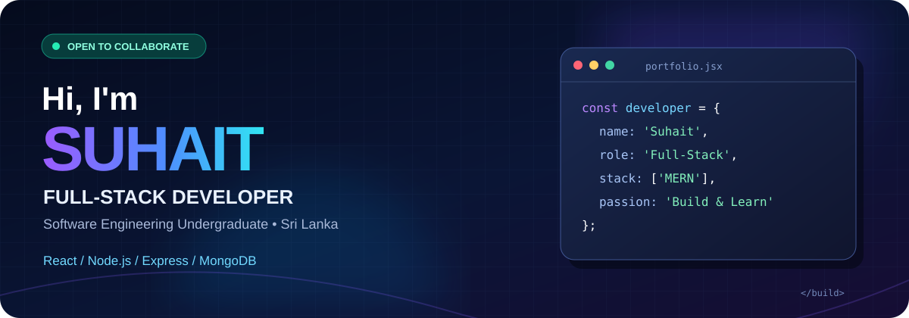

🚀 Turning Ideas Into Real Applications
Building useful, accessible web applications and solving real-world problems through code.

👨‍💻 About Me
<table>
<tr>
<td width="62%" valign="top">

Hi! I'm Suhait, a Software Engineering undergraduate based in Sri Lanka 🇱🇰. I enjoy building practical, user-friendly applications and learning how reliable software is designed, developed, and tested.
- 🎓 Studying Software Engineering
- 💻 Working with React, Node.js, Express & MongoDB
- 🏥 Developing a Doctor Appointment Management System
- 🌱 Improving my JavaScript, Java, Git, testing & system design skills
- 🤝 Interested in collaboration and meaningful projects
- 🎯 Goal: Build maintainable applications that solve real problems
</td>
<td width="38%" valign="top">

const suhait = {
  role: "Full-Stack Developer",
  location: "Sri Lanka 🇱🇰",
  stack: ["React", "Node.js", "MongoDB"],
  mindset: "Build • Learn • Improve"
};
</td>
</tr>
</table>

🛠️ Tech Stack & Tools

Frontend

Backend & Databases

Languages & Developer Tools

🌟 Featured Projects
<table>
<tr>
<td width="50%" valign="top">

🏥 Doctor Appointment Management System
MERN Stack · Full-Stack Application

Online patient booking, doctor availability management, and role-based dashboards for patients, doctors, and administrators.

Status: Preparing the repository, documentation and demo.
</td>
<td width="50%" valign="top">

🩸 Online Blood Bank Management System
Management System

A project focused on organizing blood-bank information and related workflows.

</td>
</tr>
<tr>
<td width="50%" valign="top">

🚗 Online Car Rental Management System
Management System

A project exploring car rental operations and management workflows.

</td>
<td width="50%" valign="top">

🧠 React Quiz App
React · Interactive UI

An interactive quiz application developed with React.

</td>
</tr>
</table>

🧩 I'm improving project READMEs with screenshots, setup instructions, architecture diagrams, testing notes, and live demos where available.

📊 GitHub Insights

Stats are generated by third-party services and may occasionally be unavailable. Language breakdown reflects repository code, not proficiency.

🐍 Contribution Snake

<picture>
  <source media="(prefers-color-scheme: dark)" srcset="https://raw.githubusercontent.com/Suhaitsht/Suhaitsht/output/github-snake-dark.svg" />
  <source media="(prefers-color-scheme: light)" srcset="https://raw.githubusercontent.com/Suhaitsht/Suhaitsht/output/github-snake.svg" />
  
</picture>

The snake appears after the GitHub Actions workflow generates and publishes the SVG files to the <code>output</code> branch.

🤝 Let's Connect

Have an idea or a project worth building?
I'm always interested in learning, collaborating, and creating useful software.

Build • Learn • Grow • Repeat 💜

<h2 align="center">📊 GitHub Activity</h2>

  

  

 

  

